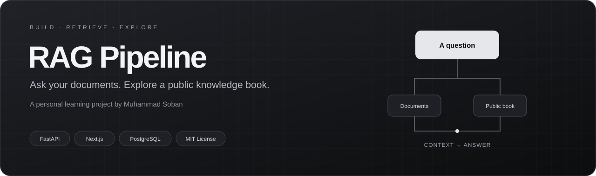
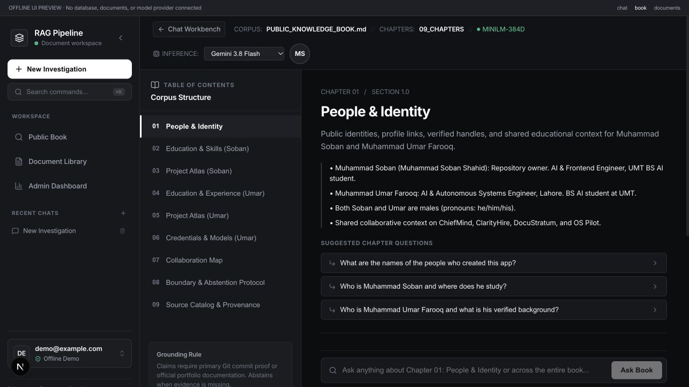
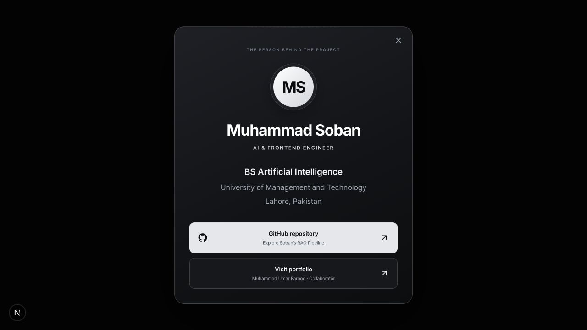
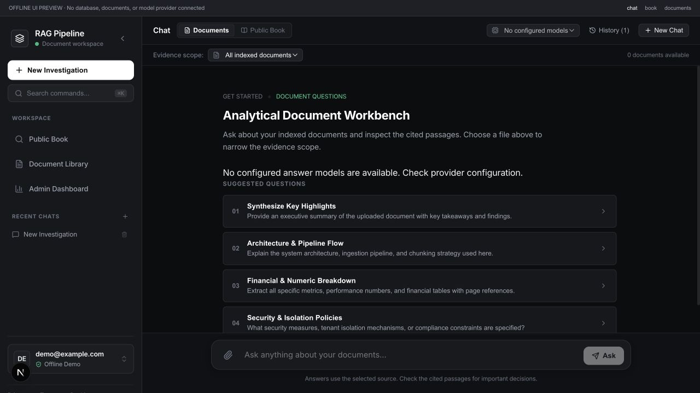
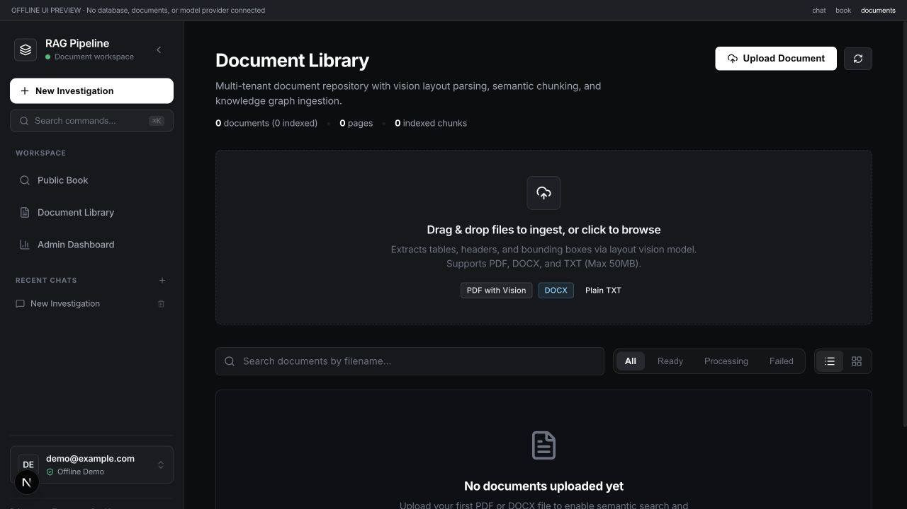
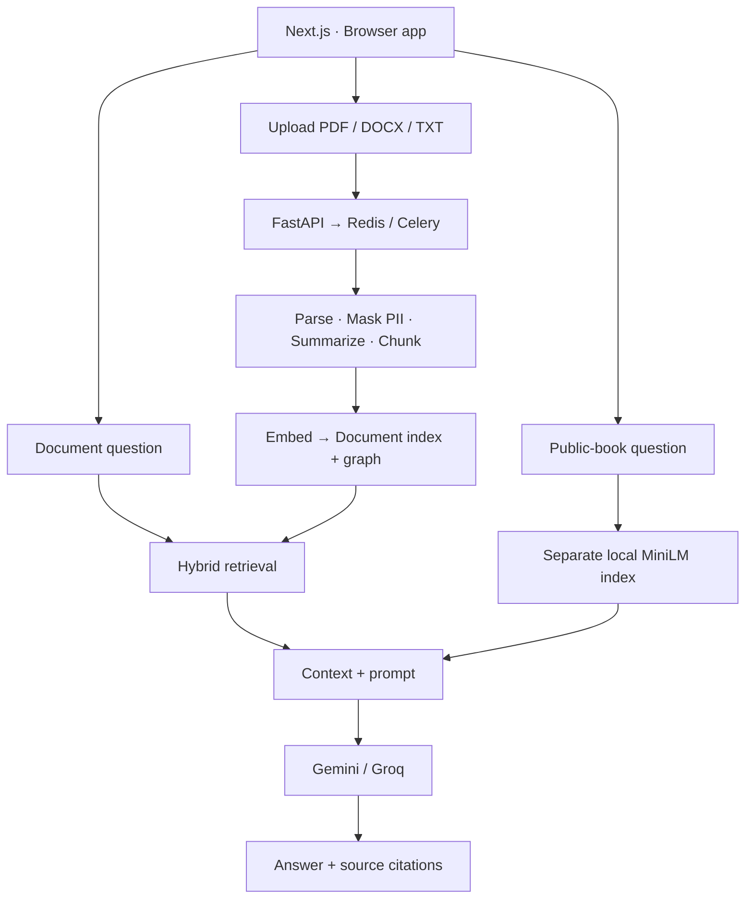

<p align="center">
  
</p>

<p align="center">
  <a href="#app-gallery">Screenshots</a> &nbsp;·&nbsp;
  <a href="#what-you-can-explore">Explore</a> &nbsp;·&nbsp;
  <a href="#two-separate-rag-paths">How it works</a> &nbsp;·&nbsp;
  <a href="#local-setup">Run locally</a> &nbsp;·&nbsp;
  <a href="#checks-and-limitations">Checks</a> &nbsp;·&nbsp;
  <a href="LICENSE">MIT License</a>
</p>

# RAG Pipeline

A personal project by **Muhammad Soban** for learning and experimenting with retrieval-augmented generation. It combines a document chat app with a separate public knowledge book explorer.

> **Project status · Personal / experimental**
> Built to learn, inspect, and improve RAG workflows. Complete answer grounding and production readiness have not been established.

| API | Interface | Search & storage | Background work | Answer providers |
| :--- | :--- | :--- | :--- | :--- |
| FastAPI · Python | Next.js · TypeScript | PostgreSQL · pgvector | Redis · Celery | Gemini · Groq |

## People and links

| Repository owner | Collaborator |
| :--- | :--- |
| **[Muhammad Soban](https://github.com/Sobanshahid10)** | **Muhammad Umar Farooq** |
| [Project repository](https://github.com/Sobanshahid10/RagPipeline) | [Personal portfolio](https://omerfarooq223.github.io) |

The **MS** profile button in Public Book introduces Soban and links to the repository and Umar’s portfolio. Soban’s identity, education, and projects appear first in the explorer.

## App gallery

<p align="center">
  <sub>A CLOSER LOOK AT RAG PIPELINE</sub><br />
  <strong>One workspace. Two ways to explore your sources.</strong><br />
  Click any image for the full-size view.
</p>

<p align="center">
  <a href="assets/readme/public-book.png"></a>
</p>
<p align="center">
  <sub>01 — THE EXPLORER</sub><br />
  <strong>Public knowledge book</strong><br />
  Browse the chapters, meet the people, and follow the sources.
</p>

<table>
  <tr>
    <td width="33%" align="center" valign="top">
      <a href="assets/readme/owner-card-centered.png"></a>
      <p align="center"><sub>02 — THE OWNER</sub><br /><strong>Muhammad Soban</strong><br />Meet the developer behind the project.</p>
    </td>
    <td width="33%" align="center" valign="top">
      <a href="assets/readme/chat.png"></a>
      <p align="center"><sub>03 — THE WORKBENCH</sub><br /><strong>Document chat</strong><br />Choose a source. Start with a question.</p>
    </td>
    <td width="33%" align="center" valign="top">
      <a href="assets/readme/documents.png"></a>
      <p align="center"><sub>04 — THE LIBRARY</sub><br /><strong>Your documents</strong><br />Upload, organize, and track processing.</p>
    </td>
  </tr>
</table>

<p align="center"><sub>Interface screenshots from an isolated offline preview with a demo account and empty document/model fixtures.<br />These views show the UI, not live retrieval, successful ingestion, or generated answers.</sub></p>

## What you can explore

| Bring your documents | Explore the public book |
| :--- | :--- |
| Upload **PDF, DOCX, or TXT** and follow processing status | Browse **nine chapters** without uploading the book |
| Ask across your workspace or choose a document | Query a separate, prepared **MiniLM index** |
| Inspect passages and original-file previews | Inspect retrieved passages and source references |

**Across the app:** per-request Gemini / Groq selection, account-scoped history, model preferences, and an admin metrics dashboard. Provider failures are shown without silently switching providers. Page regions appear only when reliable coordinates are available.

## Two separate RAG paths

### Uploaded documents

`/documents` and `/chat` use the tenant document pipeline. Uploading saves a file and queues a Celery job to parse it, mask PII, summarize, chunk, embed, index, and extract graph triples. The worker must be running for processing to finish. An accepted upload does not mean the file has finished indexing; check its status first.

When a question is submitted, the backend retrieves context, builds a prompt, and generates an answer. Retrieval combines full-text search, dense vector search, and graph traversal. With a Gemini key configured, this path uses `gemini-embedding-2` at 1536 dimensions. Changing embedding models requires reindexing the affected documents.

### Public knowledge book

`/public-book` and `/api/v1/public-book/ask` query the existing public-only index built from `PUBLIC_KNOWLEDGE_BOOK.md`. This path uses local `all-MiniLM-L6-v2` embeddings at 384 dimensions, with its own scripts and artifacts.

The educational workflow has 11 explicit steps: parse, normalize, chunk, add metadata, embed, index, retrieve, rerank, build context, assemble a prompt, and generate an answer. See the [step guides](docs/STEP_01_LOAD_PARSE.md) and the other `docs/STEP_*.md` files. The step-eleven CLI uses Gemini; the browser page supports Gemini and Groq.

Public-book answers receive structural answer and citation validation. Semantic grounding and formal G-Eval remain incomplete. Uploading a document does not run this learning workflow or G-Eval.

Keep `storage/private/` and personal chats outside the public corpus, index, and public-book requests.

## Architecture



<details>
<summary><strong>Supporting tools</strong> — tracing, analytics, and evaluation</summary>

OpenTelemetry / Jaeger provide tracing when configured. dbt models support analytics, pytest covers regressions, and Locust provides load-test tooling. Their presence does not establish a performance or reliability guarantee.

</details>

## Local setup

### Requirements

- Docker with Compose for PostgreSQL, Redis, and optional container services.
- Python 3.11+ and Node.js for running the backend and frontend directly.
- A configured model provider for generated answers. Live calls consume provider quota.

### 1. Clone and configure

```bash
git clone https://github.com/Sobanshahid10/RagPipeline.git
cd RagPipeline
cp .env.example .env
```

Populate the required settings in the ignored root `.env`: `DATABASE_URL`, `REDIS_URL`, and a unique `JWT_SECRET`. Set `RUNTIME_DB_PASSWORD` when overriding the development database password. Use the restricted `rag_runtime` database role for application access.

For host-run services, PostgreSQL is exposed on **5433** and Redis on **6380**. The Compose services use their internal container ports instead. See [security remediation and configuration notes](SECURITY_REMEDIATION.md) for existing database volumes and runtime-role setup.

Optional provider settings include `GEMINI_API_KEY`, `GROQ_API_KEY`, `LLM_PROVIDER`, `LLM_MODEL`, and `EMBEDDING_MODEL`. Both provider keys can coexist. A model chosen in chat overrides the default answer model for that request. Restart the backend after changing `.env`; never put provider keys in frontend code or commit them.

The configured answer choices are maintained in [frontend/lib/models.ts](frontend/lib/models.ts) and the backend request allowlists. Provider availability depends on the configured account and keys.

### 2. Start the document-app services

```bash
docker compose up -d --build
```

| Service | Local address |
| --- | --- |
| Backend API documentation | [localhost:8001/docs](http://localhost:8001/docs) |
| Backend health | [localhost:8001/health](http://localhost:8001/health) |
| PostgreSQL | `localhost:5433` |
| Redis | `localhost:6380` |
| Jaeger | [localhost:16686](http://localhost:16686) |

The development Compose file starts the backend, document worker, database, Redis, and Jaeger. Start the frontend separately:

```bash
cd frontend
npm ci
npm run dev
```

Open [localhost:3005](http://localhost:3005), register a workspace, and sign in. Upload a document in Documents and wait for processing to finish before asking about it in Chat.

### 3. Use the public-book explorer locally

> **Local checkout required:** the public book needs its own artifacts, cached model, and database index.

The generic backend Docker image does not include the repository-root public-book files and step modules. Its public-book endpoint returns **503**; the Compose setup alone is not sufficient for this path.

Run the backend from the repository checkout with the public-book artifacts, cached MiniLM model, and PostgreSQL public-book index present. Follow the [indexing guide](docs/STEP_06_STORE_INDEX.md) and the preceding step guides to prepare these dependencies. In a configured Python environment, start the backend from the repository root:

```bash
PYTHONPATH=".:backend" python -m uvicorn app.main:app --reload --port 8001
```

Stop the container backend first if it already occupies port 8001. The document worker is still needed for uploaded documents. Open Public Book after signing in; it queries the prepared index directly.

`docker-compose.prod.yml` and the Nginx configuration are deployment experiments, not evidence that the project is production ready.

## Project layout

<details>
<summary><strong>Open the repository map</strong></summary>

| Path | Purpose |
| --- | --- |
| `backend/app/api/` | Authentication, document, query, public-book, and admin endpoints |
| `backend/app/ingestion/` | Document worker pipeline and public-book preparation scripts |
| `backend/app/retrieval/` | Search, fusion, reranking, and public-book context assembly |
| `backend/app/generation/` | Prompts, provider calls, and citation handling |
| `backend/db/` | Database schema, runtime-role setup, and RLS policies |
| `backend/tests/` | Backend regression and integration tests |
| `frontend/app/` | Chat, documents, public book, dashboard, and informational pages |
| `frontend/components/` | Shared UI, source viewers, and repository-owner card |
| `docs/STEP_*.md` | Public-book learning workflow |
| `storage/knowledge/` | Public-book preparation artifacts |
| `evaluation/` | Evaluation scripts and benchmark tooling |
| `dbt/` | Analytics models |

</details>

## Checks and limitations

Run backend tests in a Python environment with the backend requirements installed:

```bash
PYTHONPATH=".:backend" python -m pytest backend/tests -q
```

Provider calls are mocked in the backend tests. Real PostgreSQL isolation tests are opt-in through `RAG_TEST_ADMIN_URL` and `RAG_TEST_RUNTIME_URL`; use a dedicated disposable test database.

Run frontend checks:

```bash
cd frontend
./node_modules/.bin/tsc --noEmit
npm run test:security
npm run build
```

These are verification commands, not a claim that every check passes in every environment. Source citations help inspect answers but do not guarantee correctness. PII masking, workspace authorization, and PostgreSQL RLS are implemented controls, not a security certification. Performance measurements and load-test targets are experimental rather than SLAs.

---

## License

Licensed under the [MIT License](LICENSE). Third-party dependencies and referenced source material retain their respective licenses and rights.
