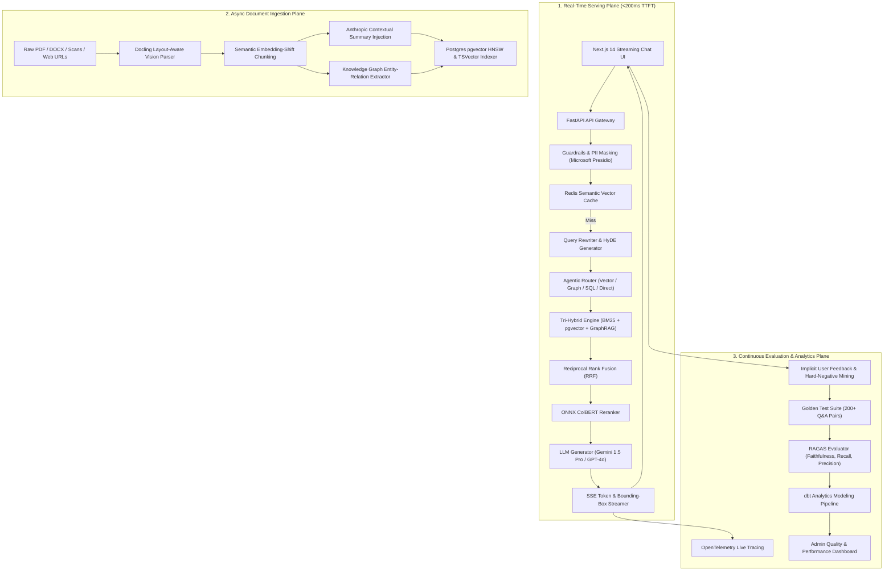

# Enterprise RAG & Evaluation Engine: Master Architecture Blueprint (2026 Edition)

> [!IMPORTANT]
> **Production Grade Standard**: This technical specification defines a tier-1, enterprise-ready **Retrieval-Augmented Generation (RAG) Platform**. It addresses real-world failure modes—such as context loss, hallucination, multi-hop reasoning gaps, and unmonitored quality regressions—through **ColBERT Late Interaction**, **GraphRAG**, **Layout-Aware Vision Parsing**, **Row-Level Security (RLS)**, and **Continuous LLM-as-a-Judge CI/CD Evals**.

---

## 1. High-Level Architecture & Plane Separation

The platform is split into three decoupled planes sharing a common PostgreSQL + Redis infrastructure:



---

## 2. Advanced Mathematical & Algorithmic Specifications

### A. Tri-Hybrid Reciprocal Rank Fusion (RRF)
To unify disparate scoring scales across lexical keyword search ($BM25$), dense vector similarity ($pgvector$), and graph traversal proximity ($GraphRAG$), candidate chunks $d$ are fused via reciprocal rank aggregation:

$$RRF(d) = \sum_{m \in M} \frac{1}{k + r_m(d)}$$

Where:
* $M = \{\text{BM25 Sparse}, \text{Dense Vector}, \text{GraphRAG}\}$
* $r_m(d)$ is the 1-based rank position of document chunk $d$ in retrieval method $m$.
* $k = 60$ (smoothing constant preventing over-weighting top-1 outliers).

### B. ColBERT Late Interaction Reranking
While standard bi-encoders condense whole chunks into a single vector (losing token-level granularity), **ColBERTv2** computes token-to-token late interaction matrix multiplication:

$$S(q, d) = \sum_{i \in q} \max_{j \in d} \left( E_i \cdot D_j^T \right)$$

Where $E_i$ represents the embedding vector of the $i$-th query token and $D_j$ represents the embedding vector of the $j$-th document token. Executed via ONNX Runtime, this delivers sub-35ms reranking precision.

### C. RAGAS Quality Metrics & Formal Definitions

#### 1. Answer Faithfulness (Hallucination Index)
Measures if every claim $c_i$ in the generated answer $A$ is strictly entailed by retrieved context $C$:

$$\text{Faithfulness} = \frac{|\{c_i \in A \mid C \models c_i\}|}{|\text{Total Claims } A|}$$

Target Threshold: $\mathbf{> 0.90}$

#### 2. Context Precision @ K
Evaluates whether relevant chunks bubble up to the top rank positions:

$$\text{Context Precision}@K = \frac{\sum_{k=1}^K (\text{Precision}@k \times v_k)}{\text{Total Relevant Chunks in Top } K}$$

Where $v_k \in \{0, 1\}$ is the binary relevance indicator at rank $k$.

---

## 3. Comprehensive Technology Architecture

| Layer | Standard RAG Implementation | Enterprise Production Engine |
| :--- | :--- | :--- |
| **Parsing & Extraction** | PyMuPDF text scraping | **Docling / ColPali Vision Parsing** (handles tables, charts, multi-column layouts) |
| **PII & Privacy** | None | **Microsoft Presidio** (automatic scrubbing of SSNs, secrets, keys before vectorization) |
| **Chunking** | Naive Token Sliding Window (512/64) | **Semantic Embedding-Shift Boundaries** + **Anthropic Global Context Injection** |
| **Search Subsystem** | Basic Vector Cosine Lookup | **Tri-Hybrid Engine** (BM25 Lexical + `pgvector HNSW` + Apache AGE GraphRAG) |
| **Reranking** | None or Python PyTorch | **ONNX-Accelerated BGE Reranker** + **ColBERT Token Late-Interaction** |
| **Query Routing** | Single Vector Search | **Agentic Router** (HyDE, Query Expansion, Redis Semantic Caching $<15\text{ms}$) |
| **Streaming UI** | Raw Markdown Text | **Structured SSE JSON Stream** with real-time PDF **Bounding Box Coordinates** |
| **Security & Auth** | API Keys | **JWT + PostgreSQL Row-Level Security (RLS)** for multi-tenant data boundaries |
| **Observability** | Console Print Logs | **OpenTelemetry** + **LangFuse Tracing** (TTFT, token costs, latency breakdowns) |
| **CI/CD Quality Control** | Untested in CI | **Tiered CI** (45s Micro-Evals on PR + Nightly Full RAGAS LLM-as-a-Judge Evals) |
| **Analytics** | None | **dbt Core Data Pipeline** (Staging, Fact, and Reporting Models) |

---

## 4. Production Database Schema (PostgreSQL 16 + pgvector)

```sql
-- Extensions
CREATE EXTENSION IF NOT EXISTS "uuid-ossp";
CREATE EXTENSION IF NOT EXISTS "vector";
CREATE EXTENSION IF NOT EXISTS "pg_trgm";

-- Multimodal Documents Table
CREATE TABLE documents (
    id UUID PRIMARY KEY DEFAULT uuid_generate_v4(),
    tenant_id UUID NOT NULL,
    filename TEXT NOT NULL,
    file_type VARCHAR(20) NOT NULL,
    doc_hash VARCHAR(64) UNIQUE NOT NULL, -- SHA-256 idempotency check
    storage_uri TEXT NOT NULL,
    status VARCHAR(20) DEFAULT 'pending', -- pending, processing, indexed, failed
    total_pages INT DEFAULT 0,
    metadata JSONB DEFAULT '{}'::jsonb,
    created_at TIMESTAMPTZ DEFAULT NOW(),
    updated_at TIMESTAMPTZ DEFAULT NOW()
);

-- Multimodal Chunks Table
CREATE TABLE chunks (
    id UUID PRIMARY KEY DEFAULT uuid_generate_v4(),
    document_id UUID REFERENCES documents(id) ON DELETE CASCADE,
    tenant_id UUID NOT NULL,
    chunk_index INT NOT NULL,
    content TEXT NOT NULL,
    contextual_summary TEXT, -- Anthropic global document summary
    page_number INT,
    bounding_box JSONB, -- [ymin, xmin, ymax, xmax] for PDF rendering
    token_count INT NOT NULL,
    embedding VECTOR(1536), -- Dense vector representation
    sparse_tsv TSVECTOR,    -- Lexical search vector
    created_at TIMESTAMPTZ DEFAULT NOW()
);

-- Fast Vector HNSW Index & TSVector GIN Index
CREATE INDEX idx_chunks_embedding_hnsw ON chunks USING hnsw (embedding vector_cosine_ops) WITH (m = 16, ef_construction = 64);
CREATE INDEX idx_chunks_sparse_tsv ON chunks USING gin (sparse_tsv);
CREATE INDEX idx_chunks_tenant ON chunks(tenant_id);

-- Knowledge Graph Triples (GraphRAG)
CREATE TABLE entity_triples (
    id UUID PRIMARY KEY DEFAULT uuid_generate_v4(),
    tenant_id UUID NOT NULL,
    source_chunk_id UUID REFERENCES chunks(id) ON DELETE CASCADE,
    subject TEXT NOT NULL,
    predicate TEXT NOT NULL,
    object TEXT NOT NULL,
    created_at TIMESTAMPTZ DEFAULT NOW()
);

CREATE INDEX idx_triples_sub_obj ON entity_triples(subject, object);

-- Real-Time Query & Observability Logs
CREATE TABLE query_interactions (
    id UUID PRIMARY KEY DEFAULT uuid_generate_v4(),
    tenant_id UUID NOT NULL,
    user_id UUID NOT NULL,
    session_id UUID NOT NULL,
    raw_query TEXT NOT NULL,
    rewritten_query TEXT,
    route_used VARCHAR(50),
    retrieved_chunk_ids UUID[],
    answer TEXT,
    ttft_ms INT,          -- Time to First Token
    total_latency_ms INT,
    prompt_tokens INT,
    completion_tokens INT,
    user_feedback INT DEFAULT 0, -- 1=Thumbs Up, -1=Thumbs Down
    created_at TIMESTAMPTZ DEFAULT NOW()
);

-- Multi-Tenant Row-Level Security (RLS)
ALTER TABLE documents ENABLE ROW LEVEL SECURITY;
ALTER TABLE chunks ENABLE ROW LEVEL SECURITY;
ALTER TABLE entity_triples ENABLE ROW LEVEL SECURITY;
ALTER TABLE query_interactions ENABLE ROW LEVEL SECURITY;
```

---

## 5. Enterprise Implementation Plan & Milestones

### Milestone 1: Core Infrastructure, Security & Ingestion Pipeline
* Setup Docker Compose (PostgreSQL `pgvector`, Redis, FastAPI, Celery, Next.js).
* Configure Row-Level Security (RLS) policies for multi-tenant document protection.
* Build Docling vision layout parser, Microsoft Presidio PII masker, and semantic chunking module.

### Milestone 2: Tri-Hybrid Search & Acceleration Engine
* Implement `pgvector HNSW` index + `BM25 tsvector` search + `Apache AGE` GraphRAG triple extraction.
* Build Reciprocal Rank Fusion (RRF) and ONNX-compiled `ColBERT` / `bge-reranker` late-interaction reranking.
* Implement LongLLMLingua contextual compression.

### Milestone 3: Agentic Routing, SSE Streaming & Next.js UI
* Build Redis Vector Semantic Cache ($<15\text{ms}$ hit response).
* Implement HyDE generator and Agentic Strategy Classifier.
* Build Next.js 14 App Router UI with PDF viewer canvas rendering bounding-box highlighted source citations.

### Milestone 4: Observability, Tiered Eval CI & Hard-Negative Mining
* Integrate OpenTelemetry live tracing with LangFuse dashboard.
* Build 200+ Q&A Golden Test Suite and GitHub Actions Tiered CI pipeline.
* Implement automated hard-negative feedback ingestion loop for user thumbs-down logs.

### Milestone 5: dbt Data Pipelines & Production Hardening
* Build dbt analytics modeling suite (`stg_interactions`, `fct_daily_performance`, `rpt_eval_dashboard`).
* Execute Locust load testing for 100 concurrent SSE streams ($<200\text{ms}$ TTFT).
* Deploy with Docker Compose / Kubernetes production manifests.
